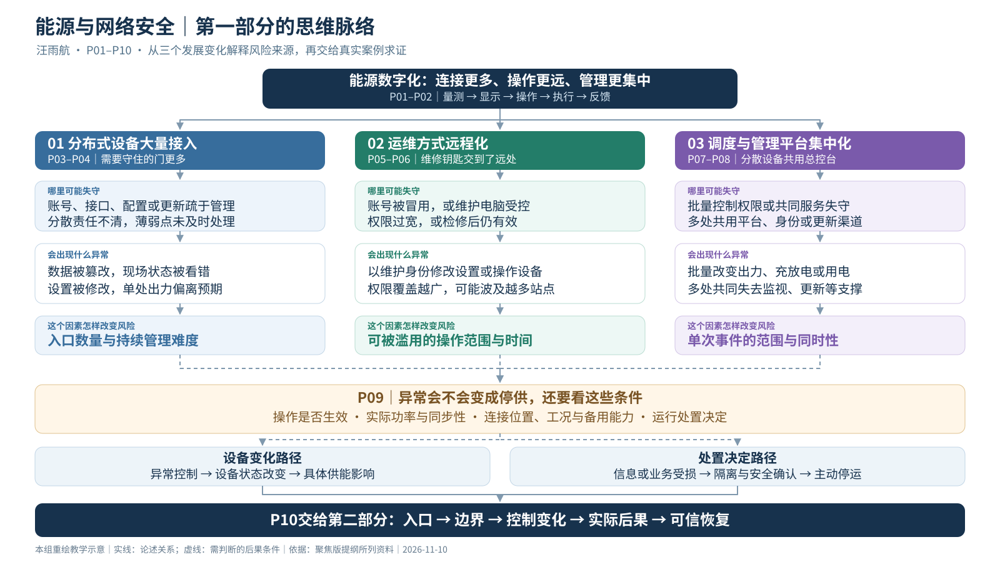

# 汪雨航｜系统架构与风险来源（聚焦版提纲）

> 负责人：汪雨航｜第一部分：P01–P10｜目标时长约13分钟，需排练验证｜面向零基础听众
>
> 修订日期：2026-11-10
>
> 按[《小组讨论提纲》](../小组讨论提纲.md)的整体逻辑及第一部分修改意见调整。

## 阅读与图表

本文件是第一部分本轮改版的内容依据。原《PPT逐页完整内容》《完整演讲逐字稿》和P01–P10图表仍对应原版结构，后续制作与排练需按本提纲同步调整；本次未将提纲扩写为完整讲稿。

导图提供[可缩放SVG](图表素材/第一部分_风险来源_思维脉络.svg)、[1600×900 PNG预览](图表素材/第一部分_风险来源_思维脉络.png)和[可编辑Mermaid源码](图表素材/第一部分_风险来源_思维脉络.mmd)。三者为同一组素材，不增加正式PPT页数。

导图展示整体思路，具体条件与假想例子以逐页提纲为准；参考资料可结合[本部分参考文献](本部分参考文献.md)与[全组核心文献](../04_全组资料/核心文献与链接.md)阅读。

## 一、内容主线与三个重点

全组主线：**风险来源 → 事件传播 → 防御改进**。

本部分以电力为主要场景，先用一张简图交代能源系统如何运行，再从能源系统发展的三个变化解释风险来源。每个重点都沿着同一条逻辑展开：

**发展变化与收益 → 哪里可能失守 → 会出现什么异常 → 这个因素怎样改变风险。**

| 发展因素 | 形象理解 | 风险主要体现在哪里 |
| --- | --- | --- |
| 分布式能源大量接入 | 需要守住的“门”更多了 | 潜在入口增多，分散设备的账号、配置与更新更难持续管好 |
| 运维方式远程化 | 维修人员有了“远程钥匙” | 外部身份或电脑失守后，原有维护权限可能被用于异常操作 |
| 调度与管理平台集中化 | 多台设备连着同一个“总控台” | 一次失守可能影响多处设备，并造成集中、同时的运行变化 |

运行工况、备用能力和处置决定放在结尾，用来解释异常能否发展为供能中断。案例细节留给第二部分，防御技术留给第三部分。

## 二、逐页提纲

### P01｜从能源数字化的便利，引出三个风险问题

- **本页任务**：说明这些变化为什么出现，以及为什么需要研究它们的风险。
- **发展与收益**：
  - 光伏、储能和充电设施分布到更多地点，参与供能与用能协调。
  - 远程维护减少现场奔波，加快故障处理。
  - 集中平台帮助工作人员统一查看和协调多处设备。
- **引出三个问题**：
  1. 接入设备更多，哪些入口可能疏于管理？
  2. 维护走向远程，谁拿着能够操作设备的钥匙？
  3. 平台统一管理，一处问题会牵动多少设备？
- **画面建议**：一张能源场景图，同时标出分散设备、远程工程师和集中平台；后续三组页面依次放大。
- **带走的认识**：理解风险，要看连接、身份和依赖关系发生了什么变化。

### P02｜一张图看懂：网络里的信息，怎样关联现实中的供电

- **本页任务**：提供理解风险所需的最少背景知识。
- **电力路径**：发电设施 → 输电线路 → 变电站 → 配电线路 → 用户。
- **控制闭环**：量测上送 → 状态显示 → 操作下发 → 设备执行 → 反馈核验。
- **必要概念**：
  - 断路器可以先理解为能接通、切断电路的工业用电闸。
  - IT主要支撑信息与业务；OT主要监视或控制实际设备。
- **形象表达**：传感器是“眼睛”，通信是“传话的线路”，控制界面是“操作台”，现场执行装置是“手脚”。
- **画面建议**：用两种颜色区分电力线路与通信连线，在操作位置标注“身份与权限检查”。控制闭环与系统角色参考 [NIST《运行技术安全指南》](https://nvlpubs.nist.gov/nistpubs/SpecialPublications/NIST.SP.800-82r3.pdf)。

### P03｜重点一：分布式设备增多，需要守住的“门”也更多

- **发展变化**：屋顶光伏、储能和充电设施分布在不同地点，涉及不同用户、厂商和运营方。
- **风险所在**：
  - 设备通过管理接口、平台或维护工具交换信息，需要管理的入口随之增多。
  - 如果账号管理、配置检查和软件更新没有跟上，部分设备就可能留下薄弱点。
  - 管理主体分散时，还可能出现“谁负责改密码、谁负责更新”不清楚的问题。
- **怎样影响风险**：增加可能被尝试利用的入口，也增加持续发现和修复薄弱点的难度。
- **形象表达**：从管理一栋楼的门，变成管理分散在许多地点的门，需要逐一确认锁、钥匙和负责人。
- **画面建议**：多处设备旁分别标出“账号”“管理接口”“更新责任”，突出管理对象增多。
- **必须说明**：这些连接可以经过平台或维护网络，并不表示每台设备都直接暴露在公共互联网。

### P04｜入口失守后，风险具体表现为什么

- **本页任务**：把“暴露面扩大”落实为能看见的异常。
- **可能表现**：
  - 信息被读取：未经授权的人获得设备信息或运行记录。
  - 数据被篡改：平台看到的状态与现场不一致，影响人员判断。
  - 设置被修改：取得相应权限后，设备可能偏离预期出力或运行状态。
- **假想例子**：某处光伏设备的管理账号被冒用，且账号具有修改设置的权限 → 运行设置被改 → 该处设备减少或停止发电。
- **讲解重点**：风险路径中的关键条件是“存在薄弱点、能够接触目标、取得相应操作能力”；仅有联网接口，还不能推出设备已经能被控制。
- **画面建议**：用“入口失守 → 信息或设置变化 → 本地运行异常”的三步图。
- **本因素结论**：主要增加入口管理与单设备失守的风险；是否波及其他设备，需要继续查清连接和权限关系。相关信息交换与设备安全问题参考 [NIST分布式能源安全指南](https://www.nccoe.nist.gov/publication/1800-32/VolB/index.html)。

### P05｜重点二：远程维护，把“维修钥匙”交到了远处

- **发展变化与收益**：工程师可以通过网络检查设备、调整参数和协助处理故障。
- **风险所在**：
  - 维护账号被冒用，或维护电脑被控制。
  - 账号获得了超出本次任务的权限。
  - 维护结束后，账号或远程连接仍长期有效。
- **风险形成过程**：外部身份或电脑失守 → 原有维护通道被利用 → 以该身份拥有的权限访问或操作系统。
- **怎样影响风险**：把外部身份问题与设备操作能力联系起来；权限越宽、保留越久，被滥用的范围和时间就可能越大。
- **画面建议**：画出“远程电脑—接入通道—目标设备”，在三处分别标明终端、身份和权限。

### P06｜同样被冒用的账号，为什么后果可能不同

- **本页任务**：讲透“能登录”和“能改变运行”之间的区别。

| 账号实际权限 | 被冒用后可能出现的表现 | 风险变化 |
| --- | --- | --- |
| 只能查看记录 | 运行信息被读取 | 主要影响信息安全 |
| 可以修改设备设置 | 参数或运行状态被异常改变 | 可能影响设备行为 |
| 可以操作多个站点 | 多处设备被未经授权地操作 | 影响范围可能进一步扩大 |

- **假想例子**：一个本应只用于检查故障的维护账号，实际还允许修改运行参数，且检修后仍有效 → 账号被冒用后，异常操作可以借助原有权限实施。
- **形象表达**：拿钥匙的人换了，系统仍可能把这个账号的操作当作正常维护。
- **必须说明**：加密保护通信过程，仍需另外判断账号使用者是否可信、操作是否得到授权；设备是否接受指令也要核验。
- **本因素结论**：风险主要表现在操作能力被冒用，以及权限过宽带来的影响扩大。相关原则参考 [澳大利亚网络安全中心的工业远程访问指南](https://www.cyber.gov.au/publication/industrial-control-systems-remote-access-protocol)。

### P07｜重点三：分散设备的操作能力，可能集中在一个“总控台”

- **发展变化与收益**：聚合平台把分散的光伏、储能和充电设施组织起来，统一监视并协调发电、充放电或用电。
- **风险所在**：
  - 具备批量控制能力的平台或高权限账号失守。
  - 多处设备依赖同一身份服务、更新渠道或管理服务。
  - 平台发出的异常指令，可能沿正常业务连接到达多台设备。
- **怎样影响风险**：使一次失守可能同时影响多个对象，扩大单次事件的范围。
- **形象表达**：许多房间各有一盏灯，但同一个总控台掌握着批量操作能力。
- **画面建议**：对比“单台设备异常”与“共同平台影响多个站点”，突出权限集中，而非只突出设备数量。

### P08｜集中风险的表现：批量变化，或共同失去支撑

- **本页任务**：具体说明共同环节失守后的两类表现。
- **表现一：多台设备接受异常操作**：
  - 发电、充放电或用电功率集中改变。
  - 假想例子：有批量控制权的平台下发异常停机命令，多个正在发电的设备接受命令，形成集中出力下降。
- **表现二：多处设备共同依赖的服务不可用或不可信**：
  - 平台不可用，工作人员可能同时失去多个站点的监视能力。
  - 共同更新渠道出问题，有问题的程序或配置可能被送往多台设备；这里的固件就是设备内部控制基本行为的软件。
- **怎样影响风险**：同时受影响的设备更多，集中发生的功率变化可能更难由系统消化；共同服务受损也可能增加判断与恢复难度。
- **必须说明**：平台失联不等于所有设备停机，要看本地运行能力；批量命令是否生效，要看设备实际接受和执行情况。
- **画面建议**：画两条分支：“平台权限失守 → 批量异常操作”和“共同服务受损 → 多处失去支撑”。相关机制参考 [美国能源部分布式能源网络安全报告](https://inl.gov/content/uploads/2023/07/Cybersecurity-Considerations-for-Distributed-Energy-Resources-on-the-U.S.-Electric-Grid.pdf)。

### P09｜从运行异常到供能中断，还需要哪些条件

- **本页任务**：区分已经出现的异常，与进一步产生的供能后果。
- **直接影响路径**：异常指令或设置 → 设备状态改变 → 在具体运行条件下影响供能。
- **需要补充判断的条件**：
  - 实际改变了多少功率，变化是分散发生还是同时发生？
  - 受影响设备连接在哪里，当时负荷多大？
  - 本地保护会怎样动作，备用设备或供电路径能否投入？
- **假想对照**：同样一条供电线路断开，若有可投入且容量足够的备用线路，可以按操作要求转供；若备用线路检修或容量不足，就可能停电。可用“道路封闭后是否具备绕行条件”解释。
- **另一条路径**：业务信息或必要支撑受损、影响范围难以判断 → 运营方为隔离攻击或确认安全而主动停运。这种后果不能直接证明现场设备已被攻击者操纵。
- **画面建议**：并列“设备变化”和“处置决定”两条路径；把功率、工况与备用能力放在后果判断位置。电网供需平衡及输送约束参考 [美国能源信息署的电力输送介绍](https://www.eia.gov/energyexplained/electricity/delivery-to-consumers.php)。

### P10｜风险来源收束：入口更多、权限可被冒用、共同环节牵动多处

- **本部分结论**：
  - 分布式设备大量接入：如果管理没有跟上，可能留下更多可利用的入口。
  - 运维方式远程化：外部身份或终端失守后，原有维护权限可能被用于异常操作。
  - 管理平台集中化：平台或共同服务失守后，一次问题可能影响多台设备或多个站点。
- **风险来源的完整表述**：能源数字化扩展了设备连接、远程操作和集中管理能力。如果身份、权限、配置、更新和共同依赖管理没有同步跟上，不可信的数据、指令或程序就可能进入运行过程。实际后果还取决于操作是否生效、受影响规模、运行工况与处置决定。
- **交给第二部分的五问**：

| 五问 | 案例中需要查清什么 |
| --- | --- |
| 入口 | 哪个账号、终端、接口或更新环节首先出了问题？ |
| 边界 | 依靠什么身份与通道，获得了多大操作范围？ |
| 控制变化 | 指令、设置、视图、通信或运行决定，实际改变了什么？ |
| 实际后果 | 发生了停电、主动停运还是恢复延迟，范围与持续时间是什么？ |
| 可信恢复 | 凭什么确认现场状态、配置、账号和必要支撑已可以安全使用？ |

- **衔接后文**：第二部分用真实事件求证传播过程；第三部分针对已经识别的薄弱点与传播环节，讨论具体防御技术。
