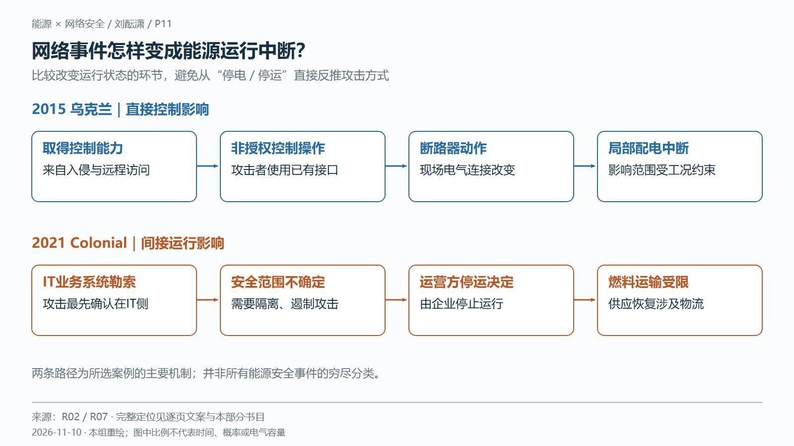
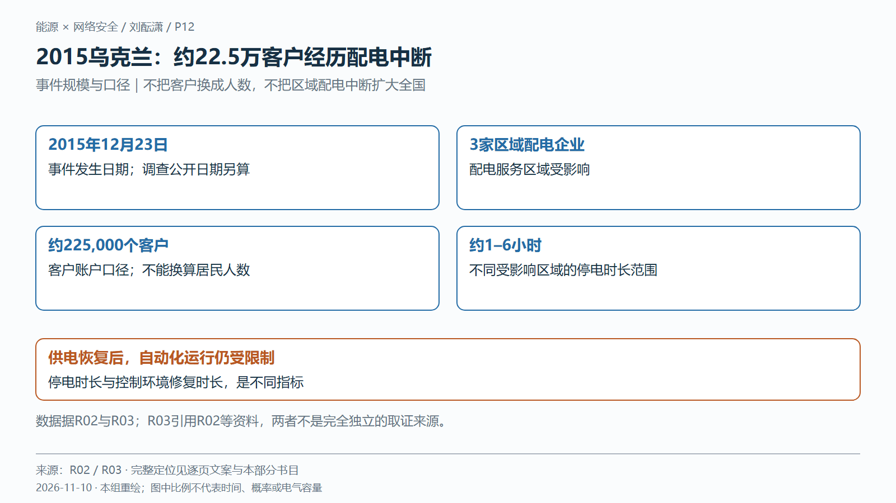
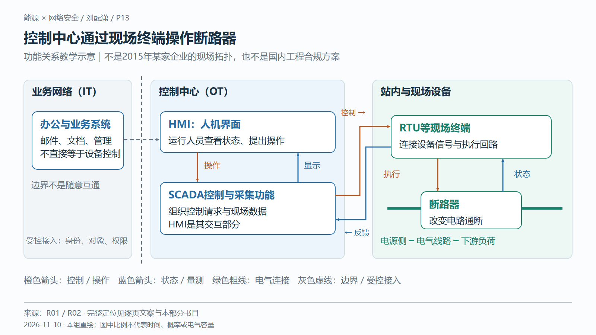
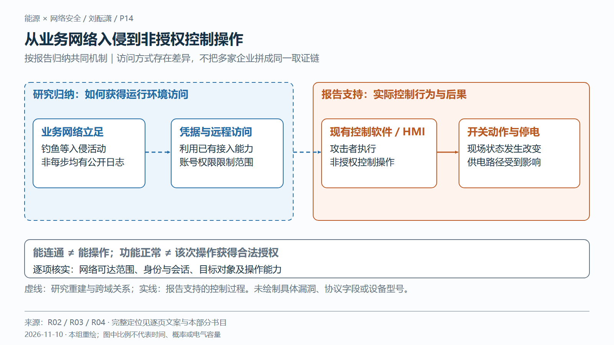
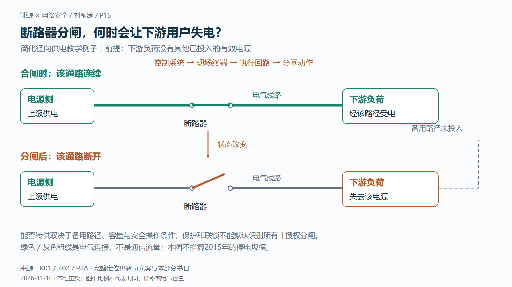
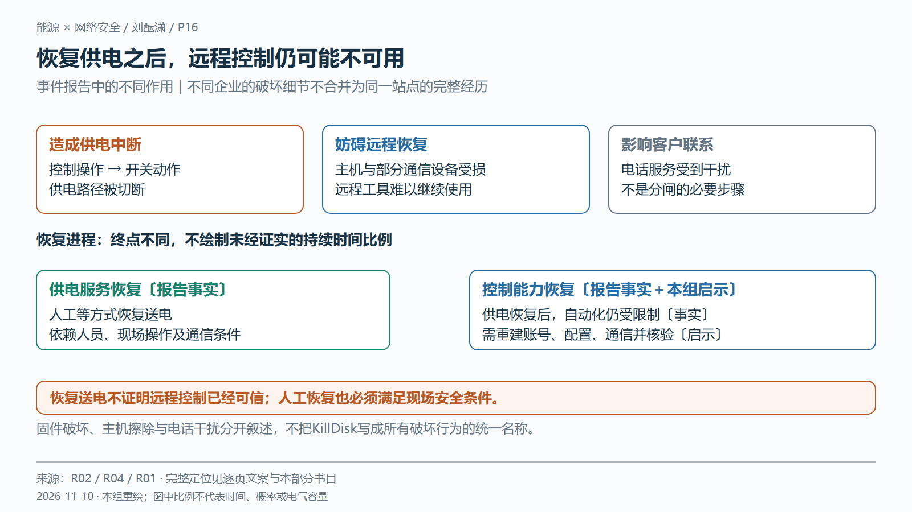
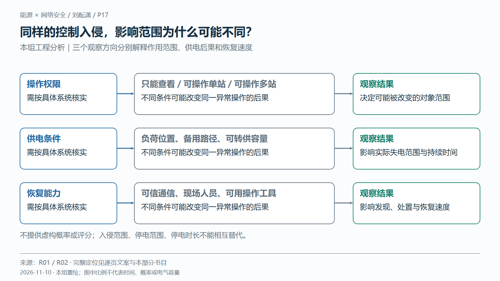
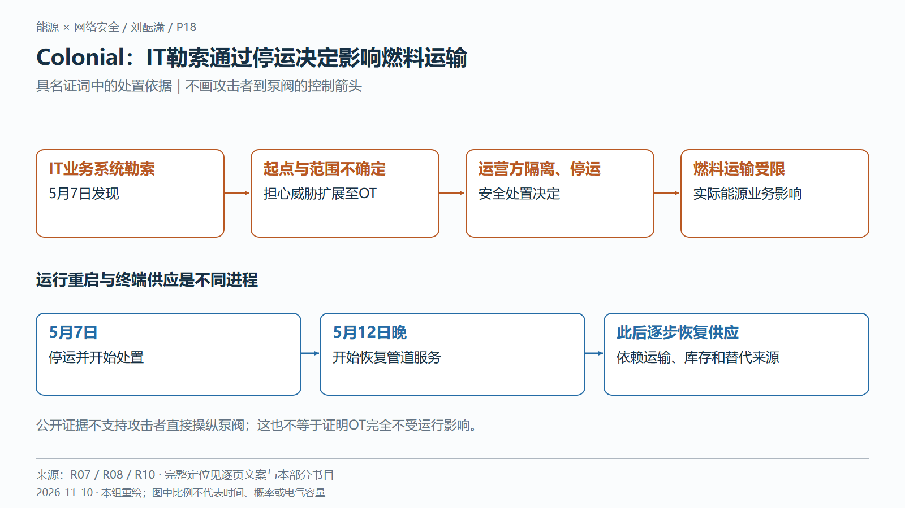
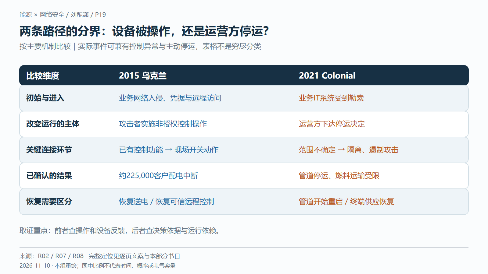
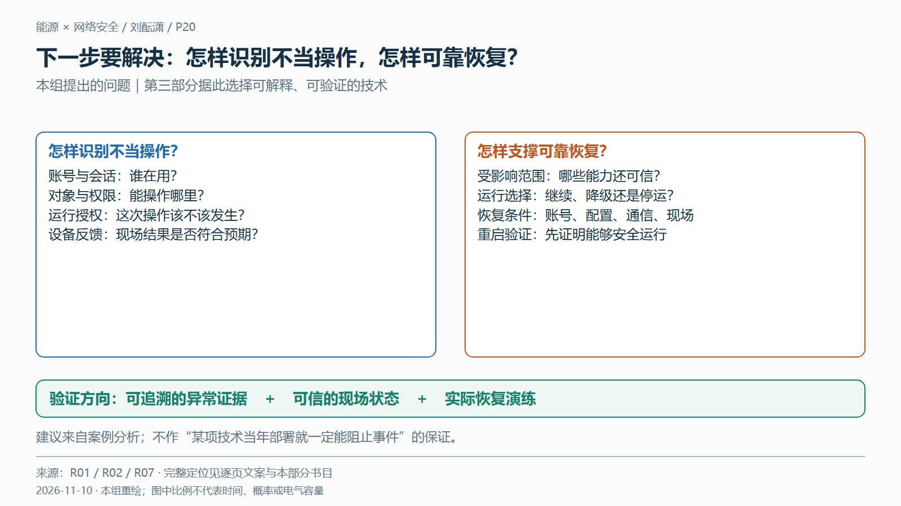

# 刘酝潇｜网络风险怎样影响能源运行

版本：2026-11-10。正式P11–P20，两个主讲案例；2016事件只作备答。**本目录为第二部分新版依据；根目录和共享资料的旧页名、计时与生成数据未修改。不要运行全组旧生成脚本覆盖本版本。**

上屏时采用每页第2项的最终文案和配图。讲稿、完整书目和问答放在备注。图示含义与证据限定应保留。

## P11｜网络事件怎样变成能源运行中断？

### 1. 核心结论与时长

关键在于：谁改变了运行状态，经过了哪些条件。

预计64秒；265汉字、265口播单位。汇报：刘酝潇。

### 2. 可直接上屏的最终文案

**网络事件怎样变成能源运行中断？**

**关键在于：谁改变了运行状态，经过了哪些条件。**

- 2015乌克兰：控制功能被滥用 → 开关动作 → 局部停电
- 2021 Colonial：IT勒索 → 运营方隔离、停运 → 燃料运输受限
- 沿着入口、权限、运行变化、后果与恢复逐项求证

图注：同为能源服务中断，改变运行的主体和中间环节不同。

简短来源：[R02] E-ISAC / SANS ICS，2016；[R07] 美国众议院国土安全委员会；Blount与Carmakal证词，2021。

### 3. 图表与讲图顺序

[SVG](图表素材/P11.svg)｜[PNG](图表素材/P11.png)｜[Mermaid逻辑源码](图表素材/P11.mmd)

两条平行路径。上轨标明攻击者非授权操作，下轨标明运营方处置决定；不把两轨串成先后过程。 讲图顺序按下方逐字稿。SVG/PNG为正式布局，Mermaid用于修改关系，不保证布局相同。

### 4. 完整逐字稿

汪雨航刚才提到，远程维护和集中管理在提高效率的同时，也让一些账号能够影响多个运行对象。可是，账号出了问题，为什么就会影响实际供能？我用两个事件把中间的过程说明白。先看二〇一五年乌克兰配电事件：攻击者利用已有控制功能，让现场开关发生动作，部分客户因此失去供电。再看二〇二一年美国科洛尼尔管道事件：受到勒索的是业务信息系统，随后是运营方决定停运，目的是隔离和遏制攻击。这两条线的关键区别，是谁改变运行状态，以及为什么改变。前者需要解释控制操作怎样到达设备，后者需要解释企业为什么认为暂时停止运行更安全。图里的箭头表示我们接下来要核实的因果关系，不表示一台办公电脑中毒就必然导致停电。

### 5. 逐页文献证据

**[R02] E-ISAC / SANS ICS（2016）**，[Analysis of the Cyber Attack on the Ukrainian Power Grid](https://www.sans.org/go/ics-defense-use-cases-duc)。

- 定位：印刷页iv–v（PDF4–5）；正文1–3、5–9（PDF7–9、11–15）；正文3明确区分恶意软件与停电机制。
- 支持：2015年事件、约225000客户、远程控制与恢复受阻。
- 边界：联合研究以公开信息与自身分析为基础；不是三家企业完整取证档案。推断和实测需区分。
- [仓库原文或存档](../sources/SANS_Ukraine2015.pdf)。

**[R07] 美国众议院国土安全委员会；Blount与Carmakal证词（2021）**，[Cyber Threats in the Pipeline: Using Lessons from the Colonial Ransomware Attack to Defend Critical Infrastructure](https://www.govinfo.gov/content/pkg/CHRG-117hhrg45085/html/CHRG-117hhrg45085.htm)。

- 定位：2021-06-09听证；Blount书面证词II、IV、V节；Carmakal有关legacy VPN与multifactor答问。
- 支持：IT勒索、主动停运、5月12日重启、遗留VPN未要求MFA。
- 边界：具名当事人及响应人员证词。说明当时决策理由，不证明该决策是唯一最优解；不补写凭据来源。
- [仓库原文或存档](../sources/R07_page.txt)。

### 6. 可能追问

**为什么只选两个事件？**

两者分别解释直接控制影响和间接运行影响，证据足够且差异明确。把时间用于控制到供能的过程，比增加相似事件更能回答老师的问题。

### 7. 制作提醒

一页只突出本页结论。保留图中证据限定与图例，避免把整段讲稿上屏。图已带标题，整图插入时不用再重复标题；改为图文分栏时只裁取主体并另留来源。建议16:9，正文字号至少22磅，来源至少12磅。

---

## P12｜2015乌克兰：约22.5万客户经历配电中断

### 1. 核心结论与时长

影响口径是区域配电客户，停电时长与控制系统恢复时间不同。

预计72秒；301汉字、301口播单位。汇报：刘酝潇。

### 2. 可直接上屏的最终文案

**2015乌克兰：约22.5万客户经历配电中断**

**影响口径是区域配电客户，停电时长与控制系统恢复时间不同。**

- 2015年12月23日；3家区域配电企业受影响
- 约225,000个客户；不同受影响区域停电约1–6小时
- 供电恢复后，自动化运行仍受限制
- 客户数不是居民人数；没有据此认定全国电网瘫痪

图注：客户不是人数；1–6小时是不同受影响区域的停电时长范围。

简短来源：[R02] E-ISAC / SANS ICS，2016；[R03] 美国DOE / DHS，2017。

### 3. 图表与讲图顺序

[SVG](图表素材/P12.svg)｜[PNG](图表素材/P12.png)｜[Mermaid逻辑源码](图表素材/P12.mmd)

事实卡仅展示日期、企业数、客户数及停电区间，不绘制无逐户数据的时长分布；恢复限制另列。 讲图顺序按下方逐字稿。SVG/PNG为正式布局，Mermaid用于修改关系，不保证布局相同。

### 4. 完整逐字稿

先把事件本身说准确。二〇一五年十二月二十三日，乌克兰三家区域配电企业遭到攻击，约二十二万五千个客户停电。这里的客户可能是家庭，也可能是企业，不能直接换算成居民人数。美国能源部和国土安全部的综合报告给出的停电时长是一到六小时，这是不同受影响区域的范围，不是每一个客户都停了六小时。我们讨论的是区域配电服务中断，也就是电力从变电站送往客户的环节受到影响，不能把它扩大成全国电网瘫痪。图中下面还有一项容易忽略的信息：供电恢复之后，企业的自动化运行能力仍受到限制。也就是说，用户重新有电，并不能证明控制中心已经恢复全部远程操作能力。下面先暂时离开攻击过程，看清运行人员平时通过什么系统查看设备、操作开关。有了这个正常工作的参照，才容易理解攻击者到底改变了什么。

### 5. 逐页文献证据

**[R02] E-ISAC / SANS ICS（2016）**，[Analysis of the Cyber Attack on the Ukrainian Power Grid](https://www.sans.org/go/ics-defense-use-cases-duc)。

- 定位：印刷页iv–v（PDF4–5）；正文1–3、5–9（PDF7–9、11–15）；正文3明确区分恶意软件与停电机制。
- 支持：2015年事件、约225000客户、远程控制与恢复受阻。
- 边界：联合研究以公开信息与自身分析为基础；不是三家企业完整取证档案。推断和实测需区分。
- [仓库原文或存档](../sources/SANS_Ukraine2015.pdf)。

**[R03] 美国DOE / DHS（2017）**，[Section 2(e): Assessment of Electricity Disruption Incident Response Capabilities](https://www.cisa.gov/sites/default/files/publications/EO13800-electricity-subsector-report.pdf)。

- 定位：封面2017-08-09；正文第6页（PDF第15页）Text Box 1。
- 支持：2015年3家配电公司、225000客户、停电1–6小时。
- 边界：本次联网403，已核对仓库原PDF第15页。用于日期、企业数、客户数、1–6小时及HMI操作；技术细分以R02校正，不沿用其将KillDisk与固件破坏混写的概括。
- [仓库原文或存档](../sources/R03_source.pdf)。

### 6. 可能追问

**为什么不说设备被毁导致停电？**

已确认的主要停电机制是控制操作导致开关状态改变。部分通信设备固件遭破坏属另一类影响，不能据此推断变压器或整个电网被物理毁坏。

### 7. 制作提醒

一页只突出本页结论。保留图中证据限定与图例，避免把整段讲稿上屏。图已带标题，整图插入时不用再重复标题；改为图文分栏时只裁取主体并另留来源。建议16:9，正文字号至少22磅，来源至少12磅。

---

## P13｜控制中心通过现场终端操作断路器

### 1. 核心结论与时长

监视与控制走通信链路，供电走电气线路。

预计81秒；340汉字、343口播单位。汇报：刘酝潇。

### 2. 可直接上屏的最终文案

**控制中心通过现场终端操作断路器**

**监视与控制走通信链路，供电走电气线路。**

- HMI显示状态并提供操作界面；SCADA组织数据采集与控制
- RTU等现场终端连接通信系统与设备信号、执行回路
- 操作向下传递；状态与量测向上反馈；断路器改变电路通断
- 教学示意：不是2015年某家企业的完整现场拓扑

图注：功能关系教学示意，不代表2015事故现场拓扑。

简短来源：[R01] Stouffer等 / NIST，2023；[R02] E-ISAC / SANS ICS，2016。

### 3. 图表与讲图顺序

[SVG](图表素材/P13.svg)｜[PNG](图表素材/P13.png)｜[Mermaid逻辑源码](图表素材/P13.mmd)

三域系统图：业务区、控制中心、现场。橙色单向控制、蓝色反向反馈、绿色无箭头电气连接；边界虚线仅表示区域边界。 讲图顺序按下方逐字稿。SVG/PNG为正式布局，Mermaid用于修改关系，不保证布局相同。

### 4. 完整逐字稿

看这张简化的配电控制图。左侧是业务网络，主要支持邮件、办公等工作；中间是运行控制区域，负责观察和操作实际设备。两者之间的接入需要受控，不能理解成所有办公电脑都能直接操纵开关。运行人员看到的画面叫人机界面，英文简称HMI，它可以显示设备状态，也可以提供操作入口。SCADA是监控与数据采集系统，负责把监视数据和控制功能组织起来，人机界面是其中人与系统交互的部分。再向右看，远程终端单元，也就是RTU等现场终端，把通信中的控制请求连接到设备执行回路，并把开关状态和量测传回控制中心。橙色箭头表示控制向现场传递，蓝色箭头表示反馈返回；底下较粗的绿色线才是电力经过的线路。软件里的请求必须经过现场接口，才可能让断路器实际动作。图中把功能分开，是为了讲清角色，实际设备可能合并或增加中间环节。这是教学示意，不能当成乌克兰某家企业的取证拓扑，也没有假定特定设备型号或通信协议。

### 5. 逐页文献证据

**[R01] Stouffer等 / NIST（2023）**，[Guide to Operational Technology (OT) Security, NIST SP 800-82 Rev.3](https://doi.org/10.6028/NIST.SP.800-82r3)。

- 定位：2.3节（印刷10–11页／PDF27–28）控制系统构成；2.3.2节（印刷12–18页／PDF29–35）SCADA及配电示例；第6章控制措施。
- 支持：OT定义、架构、性能约束、分层防御与恢复。
- 边界：用于一般原理，不证明2015现场设备配置；2023版为本次采用的版本，不宣称它是截至研究日的最新版本。
- [仓库原文或存档](../sources/NIST_SP800_82r3.pdf)。

**[R02] E-ISAC / SANS ICS（2016）**，[Analysis of the Cyber Attack on the Ukrainian Power Grid](https://www.sans.org/go/ics-defense-use-cases-duc)。

- 定位：印刷页iv–v（PDF4–5）；正文1–3、5–9（PDF7–9、11–15）；正文3明确区分恶意软件与停电机制。
- 支持：2015年事件、约225000客户、远程控制与恢复受阻。
- 边界：联合研究以公开信息与自身分析为基础；不是三家企业完整取证档案。推断和实测需区分。
- [仓库原文或存档](../sources/SANS_Ukraine2015.pdf)。

### 6. 可能追问

**HMI就是SCADA吗？**

不是。HMI是人与系统交互的界面；SCADA包含监视、采集、通信与控制等功能。RTU在现场连接设备信号和执行回路，断路器才是改变电气通断的设备。

### 7. 制作提醒

一页只突出本页结论。保留图中证据限定与图例，避免把整段讲稿上屏。图已带标题，整图插入时不用再重复标题；改为图文分栏时只裁取主体并另留来源。建议16:9，正文字号至少22磅，来源至少12磅。

---

## P14｜从业务网络入侵到非授权控制操作

### 1. 核心结论与时长

网络可达、身份通过和设备操作能力，是不同条件。

预计87秒；367汉字、368口播单位。汇报：刘酝潇。

### 2. 可直接上屏的最终文案

**从业务网络入侵到非授权控制操作**

**网络可达、身份通过和设备操作能力，是不同条件。**

- 联合研究：业务网络立足、获取凭据、利用远程访问
- 进入运行环境后，攻击者操作现有控制软件与HMI
- 正常控制功能被滥用，不代表该次操作获得合法授权
- 共同机制归纳；各企业访问方式与细节不能拼成唯一链条

图注：研究报告归纳共同机制；各企业的具体访问方式存在差异。

简短来源：[R02] E-ISAC / SANS ICS，2016；[R03] 美国DOE / DHS，2017；[R04] 美国国会研究处 CRS，2024。

### 3. 图表与讲图顺序

[SVG](图表素材/P14.svg)｜[PNG](图表素材/P14.png)｜[Mermaid逻辑源码](图表素材/P14.mmd)

传播路径图分“研究归纳”和“报告支持的控制结果”；边界标注身份、对象、操作权限；不加入漏洞、命令格式或具体型号。 讲图顺序按下方逐字稿。SVG/PNG为正式布局，Mermaid用于修改关系，不保证布局相同。

### 4. 完整逐字稿

回到真实事件，联合研究报告把业务网络中的入侵、凭据获取和远程访问联系起来。凭据可以先理解为证明账号身份的材料，例如密码；权限则规定这个账号能够访问哪些对象、执行什么操作。能连上某个网络，只说明存在通信路径；通过登录验证，也不等于获得全部设备的操作能力。这里真正影响运行的，是攻击者进一步获得了使用控制系统的能力，并通过现有控制软件实施非授权操作。报告记录了远程访问工具或类似操作员界面的不同方式，不能把它们强行写成每家企业都经历的同一套步骤。图上前半段用虚线表示研究归纳，后半段的控制操作和停电结果有报告支持。特别要注意，控制功能平时是正常运行所需要的，但攻击者使用这个功能，并没有因此获得合法授权。消息格式正常、账号能登录，与这次操作是否应该发生，是不同问题。BlackEnergy可以在备答时解释为帮助入侵的工具，但它的名称不能替代这里的机制。要继续往下判断，还得看控制请求是否实际到达设备，以及设备状态怎样变化。

### 5. 逐页文献证据

**[R02] E-ISAC / SANS ICS（2016）**，[Analysis of the Cyber Attack on the Ukrainian Power Grid](https://www.sans.org/go/ics-defense-use-cases-duc)。

- 定位：印刷页iv–v（PDF4–5）；正文1–3、5–9（PDF7–9、11–15）；正文3明确区分恶意软件与停电机制。
- 支持：2015年事件、约225000客户、远程控制与恢复受阻。
- 边界：联合研究以公开信息与自身分析为基础；不是三家企业完整取证档案。推断和实测需区分。
- [仓库原文或存档](../sources/SANS_Ukraine2015.pdf)。

**[R03] 美国DOE / DHS（2017）**，[Section 2(e): Assessment of Electricity Disruption Incident Response Capabilities](https://www.cisa.gov/sites/default/files/publications/EO13800-electricity-subsector-report.pdf)。

- 定位：封面2017-08-09；正文第6页（PDF第15页）Text Box 1。
- 支持：2015年3家配电公司、225000客户、停电1–6小时。
- 边界：本次联网403，已核对仓库原PDF第15页。用于日期、企业数、客户数、1–6小时及HMI操作；技术细分以R02校正，不沿用其将KillDisk与固件破坏混写的概括。
- [仓库原文或存档](../sources/R03_source.pdf)。

**[R04] 美国国会研究处 CRS（2024）**，[Attacks on Ukraine’s Electric Grid: Insights for U.S. Infrastructure Security and Resilience, R48067](https://www.congress.gov/crs_external_products/R/PDF/R48067/R48067.12.pdf)。

- 定位：正文第4–5页，Cyber Effects。
- 支持：2015/2016区别及2016后续保护系统分析。
- 边界：后续综合研究，2016分析不用于补全2015现场拓扑或证明设备烧毁。
- [仓库原文或存档](../sources/CRS_Ukraine.pdf)。

### 6. 可能追问

**密码被盗就能控制整个电网吗？**

不能。还需核实可达范围、账号或会话实际具有的操作能力、控制请求能否到达并被执行，以及设备连接范围。此案例不能外推成任一账号都拥有全网控制权。

### 7. 制作提醒

一页只突出本页结论。保留图中证据限定与图例，避免把整段讲稿上屏。图已带标题，整图插入时不用再重复标题；改为图文分栏时只裁取主体并另留来源。建议16:9，正文字号至少22磅，来源至少12磅。

---

## P15｜断路器分闸，何时会让下游用户失电？

### 1. 核心结论与时长

分闸切断一条电气通路；失电范围由拓扑、工况与替代供电决定。

预计87秒；369汉字、369口播单位。汇报：刘酝潇。

### 2. 可直接上屏的最终文案

**断路器分闸，何时会让下游用户失电？**

**分闸切断一条电气通路；失电范围由拓扑、工况与替代供电决定。**

- 控制请求 → 现场执行回路 → 断路器由合闸变为分闸
- 示例：唯一有效供电路径断开，下游负荷失去该电源
- 能否转供还取决于备用路径、容量和安全操作条件
- 保护、联锁不等于“所有非授权分闸都能被拦截”

图注：唯一有效供电通路的教学示意；后果还受备用与运行条件约束。

简短来源：[R01] Stouffer等 / NIST，2023；[R02] E-ISAC / SANS ICS，2016；[P2A] Bogdan Kasztenny（SEL）、Joe Rostron（Southern States），2018；2019修订。

### 3. 图表与讲图顺序

[SVG](图表素材/P15.svg)｜[PNG](图表素材/P15.png)｜[Mermaid逻辑源码](图表素材/P15.mmd)

上下对照同一简化径向馈线：合闸连续、分闸出现真实间隙；备用路径以灰色虚线表示未投入。控制箭头不得画成电能流。 讲图顺序按下方逐字稿。SVG/PNG为正式布局，Mermaid用于修改关系，不保证布局相同。

### 4. 完整逐字稿

断路器可以接通或切断电路，正常情况下也会用于检修、运行调整和故障切除。上半张图是合闸状态，电源到用户之间有连续的供电通路；下半张图中，分闸操作使触点断开，如果这是用户当时唯一有效的供电路径，下游就会失去这个电源。这里不需要先烧坏设备，改变连接状态就可能中断服务。我们故意把备用供电画在旁边，而没有自动接上，因为是否能够转供，要看备用线路是否可用、容量是否足够，以及操作是否满足安全要求。这些是一般工程条件，不是我们已经掌握了二〇一五年每个站点的运行方式。还要解释保护和联锁的作用：保护主要处理电气故障，联锁用于限制某些不安全的操作组合，它们的具体功能取决于设计，不能默认能够识别每一个被冒用的账号。对设备来说，一次非授权分闸未必表现为短路或过流，所以不能想当然地认为保护会自动阻止。案例证据支持的是攻击者通过控制系统引发开关操作并造成停电；这张图解释其中的电气关系，不声称一条命令就能让整个城市停电。

### 5. 逐页文献证据

**[R01] Stouffer等 / NIST（2023）**，[Guide to Operational Technology (OT) Security, NIST SP 800-82 Rev.3](https://doi.org/10.6028/NIST.SP.800-82r3)。

- 定位：2.3节（印刷10–11页／PDF27–28）控制系统构成；2.3.2节（印刷12–18页／PDF29–35）SCADA及配电示例；第6章控制措施。
- 支持：OT定义、架构、性能约束、分层防御与恢复。
- 边界：用于一般原理，不证明2015现场设备配置；2023版为本次采用的版本，不宣称它是截至研究日的最新版本。
- [仓库原文或存档](../sources/NIST_SP800_82r3.pdf)。

**[R02] E-ISAC / SANS ICS（2016）**，[Analysis of the Cyber Attack on the Ukrainian Power Grid](https://www.sans.org/go/ics-defense-use-cases-duc)。

- 定位：印刷页iv–v（PDF4–5）；正文1–3、5–9（PDF7–9、11–15）；正文3明确区分恶意软件与停电机制。
- 支持：2015年事件、约225000客户、远程控制与恢复受阻。
- 边界：联合研究以公开信息与自身分析为基础；不是三家企业完整取证档案。推断和实测需区分。
- [仓库原文或存档](../sources/SANS_Ukraine2015.pdf)。

**[P2A] Bogdan Kasztenny（SEL）、Joe Rostron（Southern States）（2018；2019修订）**，[Circuit Breaker Ratings – A Primer for Protection Engineers](https://cdn.selinc.com/assets/Literature/Publications/Technical%20Papers/6849_CircuitBreaker_BK_20191122_Web.pdf?v=20191202-231859)。

- 定位：印刷第1页（PDF第3页）Introduction。
- 支持：保护继电器接收电流电压信号，驱动断路器隔离故障；区分保护判断与开断执行。
- 边界：仅用于电力设备一般原理，不证明2015的保护配置。通过网页读取；不重新发布第三方PDF。
- 在线原文已核验；未在本目录重新分发。

### 6. 可能追问

**为什么保护没有阻止这次开关操作？**

保护识别的主要是电气故障，不能默认识别操作者意图。非授权分闸可能没有短路或过流。我们缺少各站具体保护逻辑，不能断言某一保护装置失效或被绕过。

### 7. 制作提醒

一页只突出本页结论。保留图中证据限定与图例，避免把整段讲稿上屏。图已带标题，整图插入时不用再重复标题；改为图文分栏时只裁取主体并另留来源。建议16:9，正文字号至少22磅，来源至少12磅。

---

## P16｜恢复供电之后，远程控制仍可能不可用

### 1. 核心结论与时长

造成中断和阻碍恢复是不同作用，供电与控制恢复也不是同一终点。

预计86秒；364汉字、364口播单位。汇报：刘酝潇。

### 2. 可直接上屏的最终文案

**恢复供电之后，远程控制仍可能不可用**

**造成中断和阻碍恢复是不同作用，供电与控制恢复也不是同一终点。**

- 开关操作造成供电中断；主机与部分通信设备受损妨碍远程恢复
- 电话干扰影响客户联系，不是断路器动作的必要环节
- 报告：通过人工等方式恢复供电，自动化运行仍受限制
- 本组启示：恢复账号、配置与通信后，还需核验现场状态

图注：报告事实与本组恢复启示分别标注；不同环境细节不拼接。

简短来源：[R02] E-ISAC / SANS ICS，2016；[R04] 美国国会研究处 CRS，2024；[R01] Stouffer等 / NIST，2023。

### 3. 图表与讲图顺序

[SVG](图表素材/P16.svg)｜[PNG](图表素材/P16.png)｜[Mermaid逻辑源码](图表素材/P16.mmd)

上层区分停电、远控受阻、客户联系受阻；下层并列供电恢复与控制恢复。箭头不暗示具体时间比例，启示单列。 讲图顺序按下方逐字稿。SVG/PNG为正式布局，Mermaid用于修改关系，不保证布局相同。

### 4. 完整逐字稿

如果设备只是断开了，重新合上是否就结束了？事件资料说明，困难还在于运行人员依赖的工具受到破坏。联合报告记录了主机数据破坏和部分通信设备固件受损，它们会让控制中心难以继续通过远程方式恢复运行；电话干扰则影响客户联系企业。这几类作用画在不同位置，因为电话服务并不是控制断路器的上游必要环节，而且不同企业的细节也不能全部合并成一个站点的故事。图下方把恢复分成两条进程：一条是通过现场人工等方式恢复供电，另一条是修复远程监视和操作能力。报告支持的事实是，供电恢复了，自动化运行仍受限制。至于重建账号、核验配置和确认通信可信，是我们依据这个差异提出的工程要求，不能说当年每家企业都按这张清单做过。人工方式也需要人员能够到场、设备支持本地操作、通信和操作规程可用，并不是随时可以按下的备用按钮。因此，恢复不只问电送回去了没有，还要问控制中心看到的状态是否可信，以及下一次操作能否被可靠执行和核对。

### 5. 逐页文献证据

**[R02] E-ISAC / SANS ICS（2016）**，[Analysis of the Cyber Attack on the Ukrainian Power Grid](https://www.sans.org/go/ics-defense-use-cases-duc)。

- 定位：印刷页iv–v（PDF4–5）；正文1–3、5–9（PDF7–9、11–15）；正文3明确区分恶意软件与停电机制。
- 支持：2015年事件、约225000客户、远程控制与恢复受阻。
- 边界：联合研究以公开信息与自身分析为基础；不是三家企业完整取证档案。推断和实测需区分。
- [仓库原文或存档](../sources/SANS_Ukraine2015.pdf)。

**[R04] 美国国会研究处 CRS（2024）**，[Attacks on Ukraine’s Electric Grid: Insights for U.S. Infrastructure Security and Resilience, R48067](https://www.congress.gov/crs_external_products/R/PDF/R48067/R48067.12.pdf)。

- 定位：正文第4–5页，Cyber Effects。
- 支持：2015/2016区别及2016后续保护系统分析。
- 边界：后续综合研究，2016分析不用于补全2015现场拓扑或证明设备烧毁。
- [仓库原文或存档](../sources/CRS_Ukraine.pdf)。

**[R01] Stouffer等 / NIST（2023）**，[Guide to Operational Technology (OT) Security, NIST SP 800-82 Rev.3](https://doi.org/10.6028/NIST.SP.800-82r3)。

- 定位：2.3节（印刷10–11页／PDF27–28）控制系统构成；2.3.2节（印刷12–18页／PDF29–35）SCADA及配电示例；第6章控制措施。
- 支持：OT定义、架构、性能约束、分层防御与恢复。
- 边界：用于一般原理，不证明2015现场设备配置；2023版为本次采用的版本，不宣称它是截至研究日的最新版本。
- [仓库原文或存档](../sources/NIST_SP800_82r3.pdf)。

### 6. 可能追问

**KillDisk和通信设备固件破坏是一回事吗？**

不是。报告分别描述主机擦除与通信设备固件破坏，不能把两者统称为KillDisk刷写。它们可能妨碍恢复，但直接导致停电的机制仍是控制系统被操作。

### 7. 制作提醒

一页只突出本页结论。保留图中证据限定与图例，避免把整段讲稿上屏。图已带标题，整图插入时不用再重复标题；改为图文分栏时只裁取主体并另留来源。建议16:9，正文字号至少22磅，来源至少12磅。

---

## P17｜同样的控制入侵，影响范围为什么可能不同？

### 1. 核心结论与时长

操作范围、供电条件和恢复能力共同决定后果。

预计80秒；336汉字、336口播单位。汇报：刘酝潇。

### 2. 可直接上屏的最终文案

**同样的控制入侵，影响范围为什么可能不同？**

**操作范围、供电条件和恢复能力共同决定后果。**

- 权限范围：能够操作一个对象，还是多个站点？
- 供电条件：受影响负荷、备用路径与可转供容量如何？
- 恢复能力：远程控制受损后，现场人员与通信能否支撑？
- 本组分析：区分“入侵范围”“实际停电范围”“持续时间”

图注：操作权限、供电条件和恢复能力分别影响后果。

简短来源：[R01] Stouffer等 / NIST，2023；[R02] E-ISAC / SANS ICS，2016。

### 3. 图表与讲图顺序

[SVG](图表素材/P17.svg)｜[PNG](图表素材/P17.png)｜[Mermaid逻辑源码](图表素材/P17.mmd)

三行条件矩阵，分别映射操作范围、实际失电范围、恢复时间；明确为本组分析，无虚构分值或概率。 讲图顺序按下方逐字稿。SVG/PNG为正式布局，Mermaid用于修改关系，不保证布局相同。

### 4. 完整逐字稿

讲到这里，可以把主案例的特点归纳出来：攻击者利用了系统已经具备的远程控制能力，而实际后果取决于这种能力能够作用到哪里。假设两个账号都被冒用，一个只能查看记录，另一个能够操作多个站点，二者带来的运行风险明显不同。但即使操作权限相同，影响也未必一样。前面那条馈线断开以后，有没有可用的备用供电路径、备用容量够不够，会改变用户失电的范围和持续时间。恢复端也一样：远程控制不可用时，有经验的现场人员和可靠通信可以帮助恢复；如果站点很多、距离很远，人工方式就会受到调度和到场时间的限制。这些是从案例出发的工程分析，并不是对二〇一五年各站点具体参数的还原。它们也回应了第一部分的远程运维和集中管理问题：集中操作的对象越多，越需要确认授权范围及现场反馈。不过，直接控制并不是唯一的影响路径。下面的管道案例里，关键变化发生在运营方的安全处置决定上。

### 5. 逐页文献证据

**[R01] Stouffer等 / NIST（2023）**，[Guide to Operational Technology (OT) Security, NIST SP 800-82 Rev.3](https://doi.org/10.6028/NIST.SP.800-82r3)。

- 定位：2.3节（印刷10–11页／PDF27–28）控制系统构成；2.3.2节（印刷12–18页／PDF29–35）SCADA及配电示例；第6章控制措施。
- 支持：OT定义、架构、性能约束、分层防御与恢复。
- 边界：用于一般原理，不证明2015现场设备配置；2023版为本次采用的版本，不宣称它是截至研究日的最新版本。
- [仓库原文或存档](../sources/NIST_SP800_82r3.pdf)。

**[R02] E-ISAC / SANS ICS（2016）**，[Analysis of the Cyber Attack on the Ukrainian Power Grid](https://www.sans.org/go/ics-defense-use-cases-duc)。

- 定位：印刷页iv–v（PDF4–5）；正文1–3、5–9（PDF7–9、11–15）；正文3明确区分恶意软件与停电机制。
- 支持：2015年事件、约225000客户、远程控制与恢复受阻。
- 边界：联合研究以公开信息与自身分析为基础；不是三家企业完整取证档案。推断和实测需区分。
- [仓库原文或存档](../sources/SANS_Ukraine2015.pdf)。

### 6. 可能追问

**能否用受攻击站点数推算停电客户数？**

不能直接推算。各站负荷、客户连接、备用方式和操作结果不同；需要现场数据。本案例保留报告客户数，不从示意图计算损失。

### 7. 制作提醒

一页只突出本页结论。保留图中证据限定与图例，避免把整段讲稿上屏。图已带标题，整图插入时不用再重复标题；改为图文分栏时只裁取主体并另留来源。建议16:9，正文字号至少22磅，来源至少12磅。

---

## P18｜Colonial：IT勒索通过停运决定影响燃料运输

### 1. 核心结论与时长

停运是运营方采取的处置；公开证据不支持攻击者直接操纵泵阀。

预计87秒；369汉字、370口播单位。汇报：刘酝潇。

### 2. 可直接上屏的最终文案

**Colonial：IT勒索通过停运决定影响燃料运输**

**停运是运营方采取的处置；公开证据不支持攻击者直接操纵泵阀。**

- 2021年5月7日：发现IT勒索，运营方为隔离、遏制攻击停运
- 当时入侵起点与范围不清，需防止威胁扩展到OT
- 5月12日晚：开始恢复管道服务；各地供应恢复仍需时间
- 遗留VPN未要求多因素认证；确切凭据获取过程不补写

图注：运营方处置决定连接IT事件与停运；重启与供应恢复不同步。

简短来源：[R07] 美国众议院国土安全委员会；Blount与Carmakal证词，2021；[R08] 美国能源信息署 EIA，2021；[R10] 美国能源部 DOE，2021。

### 3. 图表与讲图顺序

[SVG](图表素材/P18.svg)｜[PNG](图表素材/P18.png)｜[Mermaid逻辑源码](图表素材/P18.mmd)

决策路径与日期轨并列：IT事件→范围不确定→运营方停运→运输受限；5月12日晚为开始重启，不能画成零售供应全面恢复。 讲图顺序按下方逐字稿。SVG/PNG为正式布局，Mermaid用于修改关系，不保证布局相同。

### 4. 完整逐字稿

二〇二一年五月七日，美国科洛尼尔管道公司在业务信息系统中发现勒索攻击。公司负责人布朗特在国会听证中解释，员工通知控制中心后，由运营方下达停运决定，目的是隔离和遏制攻击，避免威胁进一步影响运行技术网络。当时他们还不能确定入侵从哪里开始、波及多大范围。因此图中从IT事件到管道停运之间，专门放了一个运营方处置节点，不能省略成黑客直接控制泵阀。事件响应人员还说明，相关遗留远程访问配置没有要求多因素认证，但确切的凭据获取过程不能由我们补写成某次钓鱼。五月十二日晚，公司开始恢复管道服务，这也不等于所有加油站立刻恢复正常。燃料还需要运输，市场还会受到库存和替代供应的影响。能源信息署的说明支持这种时间差。这一事件的价值在于提醒我们，网络入侵范围和能源业务影响范围不是一回事。公开资料没有证明攻击者直接操纵现场设备，仍然可以确认事件造成了运行中断。这里是在解释停运依据，并不是替企业证明当时绝无其他处置选择。

### 5. 逐页文献证据

**[R07] 美国众议院国土安全委员会；Blount与Carmakal证词（2021）**，[Cyber Threats in the Pipeline: Using Lessons from the Colonial Ransomware Attack to Defend Critical Infrastructure](https://www.govinfo.gov/content/pkg/CHRG-117hhrg45085/html/CHRG-117hhrg45085.htm)。

- 定位：2021-06-09听证；Blount书面证词II、IV、V节；Carmakal有关legacy VPN与multifactor答问。
- 支持：IT勒索、主动停运、5月12日重启、遗留VPN未要求MFA。
- 边界：具名当事人及响应人员证词。说明当时决策理由，不证明该决策是唯一最优解；不补写凭据来源。
- [仓库原文或存档](../sources/R07_page.txt)。

**[R08] 美国能源信息署 EIA（2021）**，[Cyberattack halts fuel movement on Colonial petroleum pipeline](https://www.eia.gov/todayinenergy/detail.php?id=47917)。

- 定位：2021-05-11正文第1–5段。
- 支持：停运、库存与替代运输、管道重启后终端供应仍需运输时间。
- 边界：事件进行中的官方说明，不用该文证明5月12日已经重启；重启日期依据R07。
- [仓库原文或存档](../sources/R08_page.txt)。

**[R10] 美国能源部 DOE（2021）**，[Colonial Pipeline Cyber Incident](https://www.energy.gov/ceser/colonial-pipeline-cyber-incident)。

- 定位：跨部门响应与Status Updates。
- 支持：运输豁免、燃料供应协调、恢复是跨组织过程。
- 边界：原企业状态链接已重定向；重启日期以听证证词交叉核查。
- [仓库原文或存档](../sources/R10_page.txt)。

### 6. 可能追问

**是不是计费系统坏了，所以管道必然停运？**

不能把单一业务系统当作已经证实的唯一原因。这里采用具名证词中的隔离、遏制及范围不确定解释。业务依赖可影响持续运行，但未公开的具体依赖不补画。

### 7. 制作提醒

一页只突出本页结论。保留图中证据限定与图例，避免把整段讲稿上屏。图已带标题，整图插入时不用再重复标题；改为图文分栏时只裁取主体并另留来源。建议16:9，正文字号至少22磅，来源至少12磅。

---

## P19｜两条路径的分界：设备被操作，还是运营方停运？

### 1. 核心结论与时长

相同的服务中断，需要分别寻找控制证据和决策证据。

预计80秒；339汉字、339口播单位。汇报：刘酝潇。

### 2. 可直接上屏的最终文案

**两条路径的分界：设备被操作，还是运营方停运？**

**相同的服务中断，需要分别寻找控制证据和决策证据。**

- 乌克兰：非授权控制操作 → 断路器动作 → 配电中断
- Colonial：IT勒索与范围不确定 → 隔离、停运决定 → 运输受限
- 前者核查操作、设备反馈；后者核查处置依据、运行依赖
- 网络隔离有价值；业务受影响不能反证所有隔离均失效

图注：比较主要机制，不代表两条路径互斥或穷尽全部事件。

简短来源：[R02] E-ISAC / SANS ICS，2016；[R07] 美国众议院国土安全委员会；Blount与Carmakal证词，2021；[R08] 美国能源信息署 EIA，2021。

### 3. 图表与讲图顺序

[SVG](图表素材/P19.svg)｜[PNG](图表素材/P19.png)｜[Mermaid逻辑源码](图表素材/P19.mmd)

两列对照表依次列初始系统、改变运行的人、关键机制、结果及恢复；未知不填“绝对没有”。 讲图顺序按下方逐字稿。SVG/PNG为正式布局，Mermaid用于修改关系，不保证布局相同。

### 4. 完整逐字稿

把两条路径放在同一张表里，可以避免仅凭最终结果反推攻击过程。乌克兰案例里，攻击者实施了非授权控制操作，我们需要的证据是操作行为、设备状态变化和实际停电影响。管道案例里，运营方作出了停运决定，我们需要核对的是攻击发生在哪类系统、当时知道什么，以及为什么停止运行。它们都属于能源网络安全问题，但并不要求相同的技术入侵范围。隔离网络可以限制一部分跨域访问，却不能消除所有共同业务依赖，也不能自动回答当前是否可以安全继续运行。所以，企业最终停运，不能反过来证明隔离措施完全无效；没有直接设备操纵的证据，也不能说明能源业务没有受影响。表里最后一行比较恢复：电网既要恢复送电，也要恢复可信控制；管道需要确认运行安全并逐步恢复服务，而燃料再到终端还有物流过程。两条路径并不是覆盖全部能源攻击的分类标准，一个复杂事件也可能同时存在控制异常和主动停运。

### 5. 逐页文献证据

**[R02] E-ISAC / SANS ICS（2016）**，[Analysis of the Cyber Attack on the Ukrainian Power Grid](https://www.sans.org/go/ics-defense-use-cases-duc)。

- 定位：印刷页iv–v（PDF4–5）；正文1–3、5–9（PDF7–9、11–15）；正文3明确区分恶意软件与停电机制。
- 支持：2015年事件、约225000客户、远程控制与恢复受阻。
- 边界：联合研究以公开信息与自身分析为基础；不是三家企业完整取证档案。推断和实测需区分。
- [仓库原文或存档](../sources/SANS_Ukraine2015.pdf)。

**[R07] 美国众议院国土安全委员会；Blount与Carmakal证词（2021）**，[Cyber Threats in the Pipeline: Using Lessons from the Colonial Ransomware Attack to Defend Critical Infrastructure](https://www.govinfo.gov/content/pkg/CHRG-117hhrg45085/html/CHRG-117hhrg45085.htm)。

- 定位：2021-06-09听证；Blount书面证词II、IV、V节；Carmakal有关legacy VPN与multifactor答问。
- 支持：IT勒索、主动停运、5月12日重启、遗留VPN未要求MFA。
- 边界：具名当事人及响应人员证词。说明当时决策理由，不证明该决策是唯一最优解；不补写凭据来源。
- [仓库原文或存档](../sources/R07_page.txt)。

**[R08] 美国能源信息署 EIA（2021）**，[Cyberattack halts fuel movement on Colonial petroleum pipeline](https://www.eia.gov/todayinenergy/detail.php?id=47917)。

- 定位：2021-05-11正文第1–5段。
- 支持：停运、库存与替代运输、管道重启后终端供应仍需运输时间。
- 边界：事件进行中的官方说明，不用该文证明5月12日已经重启；重启日期依据R07。
- [仓库原文或存档](../sources/R08_page.txt)。

### 6. 可能追问

**两种路径能否同时出现？**

可以。设备异常后运营方也可能扩大停运范围。这里按两个案例最有证据的主要机制比较，不是互斥且穷尽的攻击分类。

### 7. 制作提醒

一页只突出本页结论。保留图中证据限定与图例，避免把整段讲稿上屏。图已带标题，整图插入时不用再重复标题；改为图文分栏时只裁取主体并另留来源。建议16:9，正文字号至少22磅，来源至少12磅。

---

## P20｜下一步要解决：怎样识别不当操作，怎样可靠恢复？

### 1. 核心结论与时长

防御应回应具体传播环节，并用运行结果验证。

预计79秒；331汉字、331口播单位。汇报：刘酝潇。

### 2. 可直接上屏的最终文案

**下一步要解决：怎样识别不当操作，怎样可靠恢复？**

**防御应回应具体传播环节，并用运行结果验证。**

- 问题一：账号能登录时，怎样核对操作对象、授权和现场反馈？
- 问题二：IT或远程控制受损时，依据什么降级、停运和重启？
- 验证方向：可追溯异常操作；可确认现场状态；可完成恢复演练
- 本组建议：聚焦具体能力，技术效果由第三部分给出证据

图注：本组从案例提出的需求，具体技术仍需效果与运行条件证据。

简短来源：[R01] Stouffer等 / NIST，2023；[R02] E-ISAC / SANS ICS，2016；[R07] 美国众议院国土安全委员会；Blount与Carmakal证词，2021。

### 3. 图表与讲图顺序

[SVG](图表素材/P20.svg)｜[PNG](图表素材/P20.png)｜[Mermaid逻辑源码](图表素材/P20.mmd)

两列问题与验证证据，分别对接操作核验和运行恢复；标为本组建议，不承诺第三部分尚未完成的具体技术选型。 讲图顺序按下方逐字稿。SVG/PNG为正式布局，Mermaid用于修改关系，不保证布局相同。

### 4. 完整逐字稿

现在可以把案例留给第三部分的问题收敛到两个。第一个问题是，账号已经能够登录、控制消息格式也正常时，怎样判断这次操作是否得到了授权，操作对象是否正确，现场结果是否符合预期？它对应乌克兰案例中正常控制功能被滥用的环节。第二个问题是，当业务系统或远程控制受到影响时，企业依据什么继续运行、降级、停运和重启？它同时对应电网的人工恢复和管道的安全处置。我们提出的是待解决的问题，不把某种技术写成当年一定能阻止事件的答案。技术有没有价值，要看能否给出可追溯的异常线索，能否帮助确认现场状态，以及是否经过实际恢复演练。前面两起事件留下的共同认识是：从网络问题到能源中断，中间必须找出实际的控制动作或运行决定；恢复时也必须确认支撑这些动作和决定的信息是否可信。下面由吴昀轩结合这两个问题，介绍可以改善关键环节的技术及其证据和限制。

### 5. 逐页文献证据

**[R01] Stouffer等 / NIST（2023）**，[Guide to Operational Technology (OT) Security, NIST SP 800-82 Rev.3](https://doi.org/10.6028/NIST.SP.800-82r3)。

- 定位：2.3节（印刷10–11页／PDF27–28）控制系统构成；2.3.2节（印刷12–18页／PDF29–35）SCADA及配电示例；第6章控制措施。
- 支持：OT定义、架构、性能约束、分层防御与恢复。
- 边界：用于一般原理，不证明2015现场设备配置；2023版为本次采用的版本，不宣称它是截至研究日的最新版本。
- [仓库原文或存档](../sources/NIST_SP800_82r3.pdf)。

**[R02] E-ISAC / SANS ICS（2016）**，[Analysis of the Cyber Attack on the Ukrainian Power Grid](https://www.sans.org/go/ics-defense-use-cases-duc)。

- 定位：印刷页iv–v（PDF4–5）；正文1–3、5–9（PDF7–9、11–15）；正文3明确区分恶意软件与停电机制。
- 支持：2015年事件、约225000客户、远程控制与恢复受阻。
- 边界：联合研究以公开信息与自身分析为基础；不是三家企业完整取证档案。推断和实测需区分。
- [仓库原文或存档](../sources/SANS_Ukraine2015.pdf)。

**[R07] 美国众议院国土安全委员会；Blount与Carmakal证词（2021）**，[Cyber Threats in the Pipeline: Using Lessons from the Colonial Ransomware Attack to Defend Critical Infrastructure](https://www.govinfo.gov/content/pkg/CHRG-117hhrg45085/html/CHRG-117hhrg45085.htm)。

- 定位：2021-06-09听证；Blount书面证词II、IV、V节；Carmakal有关legacy VPN与multifactor答问。
- 支持：IT勒索、主动停运、5月12日重启、遗留VPN未要求MFA。
- 边界：具名当事人及响应人员证词。说明当时决策理由，不证明该决策是唯一最优解；不补写凭据来源。
- [仓库原文或存档](../sources/R07_page.txt)。

### 6. 可能追问

**为什么不直接建议“装AI就能解决”？**

案例只确定需要保护的环节，不能证明某个算法有效。技术还需说明数据来源、误报漏报、处置权限和运行代价，由第三部分用证据回答。

### 7. 制作提醒

一页只突出本页结论。保留图中证据限定与图例，避免把整段讲稿上屏。图已带标题，整图插入时不用再重复标题；改为图文分栏时只裁取主体并另留来源。建议16:9，正文字号至少22磅，来源至少12磅。

---
